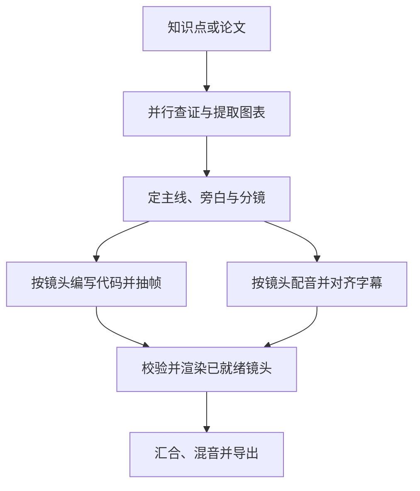

# KnoVid 知视

**让知识更好看，让创作更简单。**

KnoVid 知视是一款面向普通创作者的 AI 知识视频创作工具。我们希望让更多人用更低的成本、更顺手的流程，做出精美、易懂、让人愿意学下去的知识视频。

## 背景

AI 视频创作领域已经有即梦、可灵等工具，支持从文字、图片和参考素材生成视频，也逐步形成了完整的创作流程。影视叙事是其中一个重要方向。例如，即梦的短剧工作台围绕角色、场景、道具和镜头组织素材，可灵持续强化人物表现、动作、运镜和连续叙事能力。[即梦短剧画布使用手册](https://jimeng.jianying.com/tutorials/drama-studio/canvas) · [可灵官方产品介绍](https://ir.kuaishou.com/zh-hans/news-releases/news-release-details/kelingaixinyidaimoxingklin1g-40zhengshishangxian/)

知识教育视频有一组值得专门解决的创作需求。画面需要准确表达数字、概念和因果关系，动画需要配合讲解展示变化过程，创作者也需要方便地修正一句旁白、一条曲线或一个演示步骤。当制作需要反复生成、筛选和返工时，时间与费用都会累积。

一条精彩的知识视频，能让人对一个陌生概念产生兴趣，也能让复杂的原理变得容易理解。但制作这样的作品，往往需要兼顾内容、脚本、视觉、动画和声音。对于普通创作者，把这些环节顺畅地连接起来，仍然需要投入学习和制作成本。

知视选择在 AI 视频创作的大赛道中，聚焦教育与知识讲解，围绕内容准确、画面可控、成果可用的需求设计产品，并以程序化视频制作和多 Agent 协作降低创作门槛。

## 我们要做什么

让一个想讲清楚的知识点，或一篇希望分享的论文，成为一支知识视频的起点。

知视将内容梳理、脚本设计、动画制作、配音和成片连接成一套交互友好的创作流程。用户可以表达讲解意图、查看制作结果、提出修改，在逐步完善作品的过程中掌握内容与表达。

我们希望同时做好三件事，让作品有吸引力、让知识讲得清楚、让普通人负担得起制作与修改的成本。

## 四个设计方向

### 1. 为知识讲解设计的创作流程

从观众为什么感兴趣、哪些内容难理解出发，组织脚本和画面，把抽象概念、变化过程与数据关系转化为生动的视觉讲解。资料查证和内容审校也纳入制作流程，让表达有依据。

创作围绕知识点、讲解目标、证据和演示过程展开，让画面、旁白与节奏共同服务于观众的理解和学习兴趣。

### 2. 通过程序化制作，让画面可控、修改高效

由 AI 按照讲解内容编写场景代码，再通过渲染程序生成动画、图表和演示。文字、数值、图形与运动过程都能通过代码和参数控制，发现问题可以定位修改，已有成果可以复用。

程序化制作提供精细控制和重复渲染的能力，资料查证与内容审校负责核对知识表述，两者共同支撑知识视频对准确性和可修订性的要求。

### 3. 通过多 Agent 协作，降低制作成本

让导演、编剧和制作 Agent 分工协作，根据任务难度与质量要求，在不同能力和成本的模型之间动态选择。复杂的内容规划与场景设计使用能力更强的模型，常规整理与格式处理交给成本更低、满足任务要求的模型。

通过并行制作、结果复用和局部重做，把计算资源用在影响作品质量的环节，减少重复生成与返工，提升制作效率和可用成片比例。

### 4. 用自然的交互，让普通人掌握创作

用户可以用日常语言表达想法，查看脚本和画面预览，再提出“这里讲慢一点”“这个过程演示清楚一些”等修改。把复杂的制作过程变成能理解、能参与、能逐步调整的创作体验。

修改可以定位到具体片段，用户能够调整旁白、画面和节奏，逐步把作品改到满意。

以上是产品定位与设计方向。低成本、高效率和高成片率是设计目标，后续将通过实际制作成本、耗时和可用成片比例验证。

## 日新 · 用作品反馈改进下一次创作

日新把作品发布后的播放数据带回创作工作台。每个成功生成的视频版本都有一条独立的复盘记录。系统从视觉方向和分镜提取风格摘要，创作者可以修订摘要、统一风格分类，并手动回填发布后的播放量。复盘记录仅对对应账号或访客可见。

1. 在侧栏打开「日新」，找到已发布的视频版本，检查风格名称和摘要。
2. 填写累计播放量，点击「保存复盘」。留空表示尚未统计，填写 `0` 表示实际零播放。
3. 在「风格表现」查看各风格的样本数、平均播放量和择优评分。登录后，可以在创作工作台的「视频风格」中选择「日新择优」。系统会把排名第一的风格及其组内播放量最高的作品摘要作为新视频的参考。如果还没有播放数据，系统使用网站默认风格。

排名只统计已录入播放量的视频。同名风格会归为一组，名称比较时统一全半角、大小写和多余空格。评分用全体已录入视频的平均播放量补入两个样本，使样本少的风格评分更接近整体平均。

```text
择优评分 =（该风格总播放量 + 2 × 全体平均播放量）÷（该风格样本数 + 2）
```

比较风格时，尽量使用同一平台、同一发布后时长的播放数据。选题和发布时间也会影响播放量。 [打开日新](https://knovid.art/rixin)

## 实现架构

KnoVid 的生产流水线接收知识点、论文 PDF 或论文链接，输出有声 MP4 和可编辑项目包。**Agent 按创作职责命名，Worker 按执行能力部署。** 同一个项目可以为多个段落同时派发同一类 Agent 任务，容器副本数按负载和资源配置。

### Agent 分工

| Agent | 职责 | 交付物 |
|---|---|---|
| Director 导演 | 确定目标观众、讲解主线和全片视觉规则，为每个镜头定义教学目标。 | 创作简报、分镜和镜头任务单 |
| Researcher 研究员 | 检索可靠资料，或从论文提取方法、图表、结果与适用条件。正文查证和图表提取可并行。 | 带链接、页码、图号或表号的证据清单 |
| Writer 编剧 | 根据证据写分段口语旁白，标出应与画面配合的重点句。 | 旁白、证据引用和关键句标记 |
| Motion Designer 动效师 | 按镜头编写 Canvas 2D、SVG 或 HTML/CSS 场景代码，定义可编辑参数，检查画面关键帧。 | 场景源码、参数定义和预览 |
| Voice Director 配音导演 | 统一音色和表达风格，给每段旁白标注发音、重音、语速和停顿。 | 音色设置和逐段配音指令 |
| Reviewer 审片员 | 核对关键结论、数值和单位，检查排版、字幕及音画同步。 | 带场景编号和时间点的返修意见 |

Director 负责创作决策。调度器根据依赖关系派发任务，记录进度和版本。TTS、字幕对齐、Remotion 渲染与最终混音由程序任务执行。模型按任务选择，复杂规划和原创场景优先使用能力更强的模型，常规整理可交给成本较低的模型。

### 任务依赖与并发



两种输入共用同一套分镜结构。知识点先查证，论文保留页码、图表编号和实验条件。图表动画使用可核对的数值，原始数值缺失时可在论文原图上做高亮。每个镜头记录证据引用、旁白、画面变化和关键句标记。

分镜确定后，画面和声音同步制作。动效师可以先写「讲到结果时高亮曲线」的动作，等旁白生成后，再按实际时间戳把动作换算成帧。代表镜头优先出带声音的预览，其他镜头可同时取材、试音和写初稿。单段的代码、音频和检查结果齐全后即可渲染。较重的镜头可以再切成帧区间分发，最终按顺序合并。全片字幕位置、配乐和进度条由总时间轴统一计算。[Remotion 分布式渲染](https://www.remotion.dev/docs/distributed-rendering)

### 编排、部署与产物

| 部分 | 设计 |
|---|---|
| 工作台与 API | 提交知识点或论文，显示分镜、证据和任务进度。用户可编辑场景参数、旁白和顺序，预览并单独重渲指定段落。 |
| 工作流编排 | 采用 Temporal + TypeScript。每条视频对应一条工作流，模型调用、TTS、抽帧和渲染作为独立任务。工作流记录依赖和结果，按场景重试与恢复。 |
| Worker 部署 | 采用 Docker Compose，按资料处理、模型调用、配音和渲染划分任务队列。Worker 可以独立增减，模型和配音并发受接口配额约束，渲染并发按 CPU、内存及 Remotion 容器内并发共同分配。 |
| 场景执行 | 复用 2.0 的 Remotion 时间轴，以及场景模块的 `renderFrame` 和 `paramSchema`。新场景按项目版本打包，预览和正式导出都在独立容器执行。执行器读取只读素材并写入任务输出目录，生成的代码无法访问模型凭据或 Docker 控制接口。 |
| 项目与版本 | 任务只传项目版本、场景 ID 和输入引用。证据、分镜、源码、音频和视频存为项目产物，产物绑定生成时的版本。输入一致时可复用结果，任务重试时可继续使用已完成的产物。 |

[Temporal 工作流](https://docs.temporal.io/workflows) · [Docker Compose 扩缩容](https://docs.docker.com/reference/cli/docker/compose/up/) · [BoHack 2.0 交接](../2.0/架构/HANDOFF.md)

修改旁白时，重新合成对应段落的音频和字幕，重算受影响的动作帧与场景长度，再更新整片合成。只改配乐时，重新混音即可。审核意见根据问题回派给编剧、动效师或配音导演。

### 首轮验证

用一个新知识点和一篇未做过的论文验证同一条流水线。论文视频应能定位关键证据、生成一个专属动画并导出完整成片。再修改一句旁白，检查字幕和动作能否重新对齐，以及其他镜头能否复用。渲染侧用同一篇论文对比 1、2、4、8 个槽位，记录首个有声镜头、完整成片和局部返修的耗时，同时记录模型和配音调用成本。
